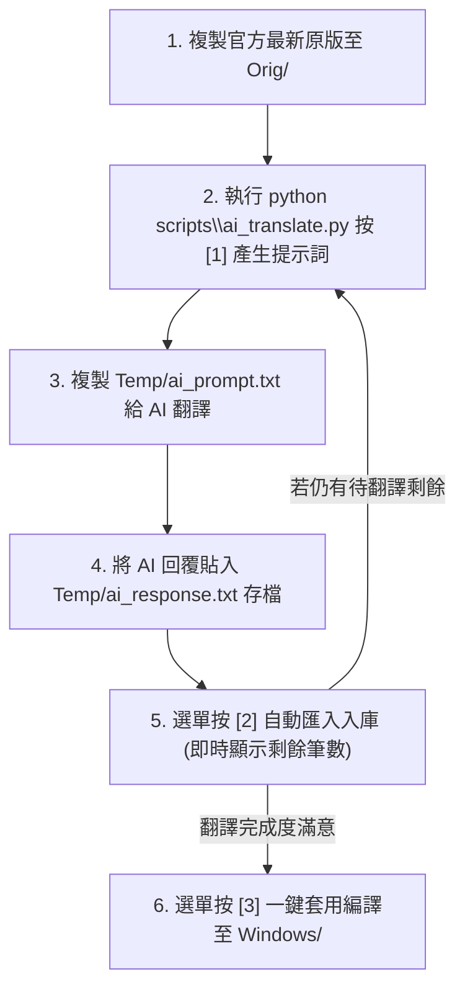

# GitHub Desktop 繁體中文在地化專案 🇹🇼

針對 **GitHub Desktop**（Windows 版）的繁體中文在地化套件與自動化翻譯工具。  
本專案提供預編譯的中文化檔案，並內建**全自動互動式數字選單**與 **AI 協同翻譯工作流**，讓任何人都能在官方釋出新版本時，一鍵提取、配合 AI 全自動翻譯、輕鬆產出最新版的繁中介面！

---

## 📌 版本支援

- **GitHub Desktop 官方最新版本**：`v3.6.10`
- **系統需求**：Windows 10 / 11、Python 3.8+（僅自行編譯/翻譯時需要）

---

## 🚀 快速安裝（一般使用者）

如果你只想直接使用繁體中文化版本：

1. **關閉 GitHub Desktop**（請確保背景處理序已完全結束）。
2. 下載或取得本專案 `Windows/` 資料夾內的兩個檔案：
   - `Windows/main.js`
   - `Windows/renderer.js`
3. 將這兩個檔案複製並覆蓋到你的 GitHub Desktop 安裝路徑：
   ```text
   %LOCALAPPDATA%\GitHubDesktop\app-*\resources\app\
   ```
4. 重新啟動 GitHub Desktop，即可享受繁體中文介面！

---

## 🎮 最無腦操作：全自動互動式選單工作台

為了免去使用者反覆手動打各類指令的困擾，本專案提供**全自動互動式數字選單**！

👉 **啟動方式**：直接在專案根目錄開啟終端機（PowerShell 或 CMD），執行以下指令即可進入選單：
```powershell
python scripts\ai_translate.py
```

```text
============================================================
      🇹🇼 GitHub Desktop 繁體中文化 - 自動化工作台
============================================================
  📊 翻譯進度：[已完成 188 / 762 筆] (24.7%)
  ⏳ 待翻譯剩餘：574 筆  |  📚 字典累積收錄：1848 條
------------------------------------------------------------
  [1] 掃描並產生 AI 提示詞 (自動抓取未翻譯，可自訂數量或 all)
  [2] 貼上/匯入 AI 翻譯結果 (智慧對齊空格與即時進度更新)
  [3] 一鍵編譯套用 (輸出至 Windows/ 目錄)
  [4] 字典健檢與過時詞條清理 (顯示無效筆數，提供刪除/保留選擇)
  [5] 開啟專案工作資料夾 (Temp / Windows / Orig)
  [0] 離開工作台
============================================================
👉 請輸入選項數字 [0-5]:
```

### ✨ 特色亮點
- **智能過濾（不重複翻譯）**：掃描時**自動排除目前已收錄的譯文**，只專注翻譯官方新版中未翻譯的新字串，大幅省時與節省 AI Token！
- **自訂批次數量（大量翻新）**：
  - 在選項 `[1]` 中可**自由輸入任意數量**（例如 100, 200, 300 等），或輸入 **`all`** 一次性匯出所有未翻譯字串，極致高效！
- **字典健檢與過時清理**：
  - 官方升級改版時，自動比對並統計過時/無效字串數量，提供保留或刪除選項，讓套用達到 0 警告乾淨輸出！
- **未翻項目自動回流**：AI 回覆若有漏翻，自動保留在「待翻譯池」，下次產生提示詞自動涵蓋，不需手動維護補翻檔案！

---

## 🤖 翻譯標準工作流程（搭配 AI 互動）



### 詳細四步操作指南

#### 步驟 1：準備官方新版檔案
將官方新安裝目錄 `%LOCALAPPDATA%\GitHubDesktop\app-*\resources\app\` 內的未修改檔案覆蓋至專案的 `Orig/` 目錄：
- `Orig/main.js`
- `Orig/renderer.js`

#### 步驟 2：選單按 `[1]` 產生提示詞
- 系統自動掃描 `Orig/`，**自動過濾已翻譯項目**。
- 可自訂本次翻譯數量（如 150 筆或輸入 `all` 全部未翻譯）。
- 自動建立包含台灣 Git 術語規範的提示詞：`Temp/ai_prompt.txt`。

#### 步驟 3：複製給 AI 並貼回存檔
1. 開啟 `Temp/ai_prompt.txt` 全選複製貼給 ChatGPT / Claude / Gemini。
2. 將 AI 回覆內容貼入 `Temp/ai_response.txt`（支援 **JSON** 或**純文字**雙格式）並存檔。

#### 步驟 4：選單按 `[2]` 匯入入庫
- 系統自動合併字典、智慧還原空格，並即時顯示已完成百分比與剩餘筆數。
- 若有未翻項目，會自動留在待翻譯清單中，下次按 `[1]` 繼續翻譯即可。
- 滿意後於選單按 `[3]` 一鍵套用編譯至 `Windows/`，覆蓋回官方目錄即大功告成！

---

## 📁 專案目錄結構

```text
├── Orig/           # 存放官方原版未修改的 main.js、renderer.js
├── Windows/        # 繁體中文成品輸出目錄（供覆蓋至安裝路徑）
├── Temp/
│   ├── UserTemp.zh      # 核心繁中對照字典檔
│   ├── ai_prompt.txt    # 自動生成的 AI 提示詞
│   └── ai_response.txt  # AI 回覆文字貼入處
├── scripts/
│   ├── ai_translate.py  # 全自動互動式工作台主程式
│   ├── apply_zh_patch.py# 底層字串批次替換引擎
│   └── validate_orig.py # 原版完整性校驗工具
└── README.md
```

---

## 📄 開源授權

本專案中文化工具與對照字典採用 [MIT License](LICENSE) 釋出。
GitHub Desktop 軟體本體著作權屬於 GitHub, Inc. 所有。
