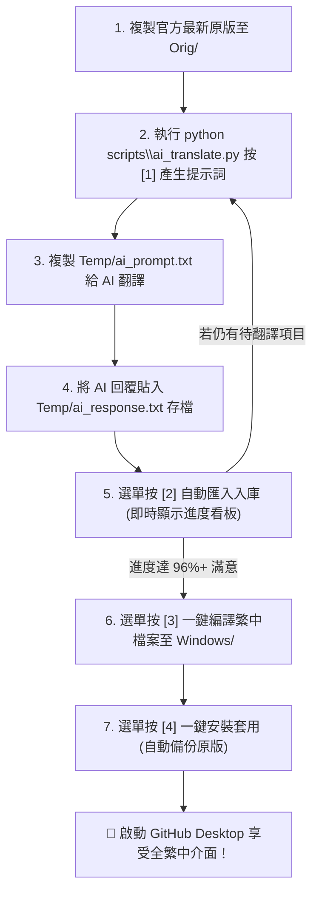

# GitHub Desktop 繁體中文在地化專案 🇹🇼

針對 **GitHub Desktop**（Windows 版）的繁體中文在地化套件與自動化翻譯工具。  
本專案提供預編譯的中文化檔案，並內建**全自動互動式數字選單**、**AI 協同翻譯工作流**，以及**一鍵安裝/自動備份/一鍵還原**機制，讓任何人都能在官方釋出新版本時，一鍵提取、配合 AI 全自動翻譯、一鍵套用至本機！

---

## 📌 版本支援

- **GitHub Desktop 官方最新版本**：`v3.6.10`
- **系統需求**：Windows 10 / 11、Python 3.8+（僅自行編譯/翻譯/自動套用時需要）

---

## 🚀 快速安裝（一般使用者）

目前編譯完成的繁中化成品存放於本專案的 **`Windows/`** 資料夾下：
- `Windows/main.js`
- `Windows/renderer.js`

本專案提供**全自動一鍵安裝**與**手動覆蓋**兩種方式：

### 方式 A：全自動一鍵安裝（推薦，含自動備份）
直接啟動工作台，選擇 **`[4]`** 即可一鍵完成安裝：
```powershell
python scripts\ai_translate.py install
```
* 🤖 **自動偵測**：自動抓取本機最新的 GitHub Desktop 安裝路徑（例如 `app-3.6.10`）。
* 📦 **安全備份**：**替換前自動將原版檔案備份**至專案 `Backups/` 目錄，確保原版檔案永不遺失！
* ⚡ **自動替換**：安全覆蓋並支援一鍵啟動 GitHub Desktop 立即驗收。

### 方式 B：手動複製覆蓋
若偏好手動操作：
1. **關閉 GitHub Desktop**（請確保背景處理序已完全結束）。
2. 將 `Windows/` 目錄下的兩個檔案：
   - `Windows/main.js`
   - `Windows/renderer.js`
3. 複製並覆蓋到你的 GitHub Desktop 安裝路徑：
   ```text
   %LOCALAPPDATA%\GitHubDesktop\app-*\resources\app\
   ```
4. 重新啟動 GitHub Desktop，即可享受繁體中文介面！

---

## 🔄 一鍵還原官方原版

若日後需要恢復官方英文原版，本專案提供完整的**一鍵還原機制**：
```powershell
python scripts\ai_translate.py restore
```
或在互動式工作台選單中按下 **`[5]`**，即可從 `Backups/` 資料夾中列出所有歷史備份，自由選擇指定版本一鍵還原回官方原版。

---

## 💡 常見問題：為什麼翻譯進度不可能達到 100%？

許多使用者在執行工作台時會發現：**為什麼 AI 提示詞全部翻譯完畢，進度卻停在 96% ~ 97%，無法達到 100%？**

> [!NOTE]
> **這是完全正常的現象，而且本來就不應該強行翻譯為 100%！**

### 原因解析：
GitHub Desktop 介面中包含許多**第三方編輯器、終端機名稱、官方品牌與技術專有名詞**，例如：
* `Visual Studio Code (Insiders)`
* `Windows PowerShell`
* `Windsurf (User)`
* `Zed Industries`
* `Android Studio`、`Sublime Text`、`IntelliJ IDEA`、`Git Bash` 等。

這些項目在官方設計與開發者日常使用中，**本來就該顯示英文原生名稱才是正常的**。若強行翻譯成中文（例如將 VS Code 硬翻為「微軟視覺化程式碼」），不僅突兀難以理解，還可能破壞外部編輯器整合關聯的辨識。

**🎉 結論**：當工作台顯示進度達到 **96% 以上**，且待翻譯剩餘皆為此類專有名詞時，**實質上 GitHub Desktop 整個介面已經 100% 完全繁體中文化**！

---

## 🎮 最無腦操作：全自動互動式選單工作台

本專案提供**全自動互動式數字選單**，將編譯、翻譯、安裝與還原全部整合在單一介面！

👉 **啟動方式**：直接在專案根目錄開啟終端機（PowerShell 或 CMD），執行以下指令即可進入選單：
```powershell
python scripts\ai_translate.py
```

```text
============================================================
      🇹🇼 GitHub Desktop 繁體中文化 - 自動化工作台
============================================================
  📊 翻譯進度：[已完成 1444 / 1493 筆] (96.7%)
  ⏳ 待翻譯剩餘：49 筆  |  📚 字典累積收錄：1854 條
------------------------------------------------------------
  [1] 掃描並產生 AI 提示詞 (自動抓取未翻譯，可自訂數量或 all)
  [2] 貼上/匯入 AI 翻譯結果 (智慧對齊空格與即時進度更新)
  [3] 一鍵編譯繁中檔案 (輸出至 Windows/ 目錄)
  [4] 🚀 一鍵安裝至 GitHub Desktop (自動偵測版本、備份原檔並套用)
  [5] 🔄 還原官方原版檔案 (從工作目錄備份還原)
  [6] 字典健檢與過時詞條清理 (顯示無效筆數，提供刪除/保留選擇)
  [7] 開啟專案工作資料夾 (Temp / Windows / Orig / Backups)
  [0] 離開工作台
============================================================
👉 請輸入選項數字 [0-7]:
```

### ✨ 特色亮點
- **智能過濾（不重複翻譯）**：掃描時**自動排除目前已收錄的譯文**與程式碼雜訊，只專注翻譯官方新版中未翻譯的新字串，大幅省時與節省 AI Token！
- **自訂批次數量（大量翻新）**：在選項 `[1]` 中可自由輸入任意數量（例如 100, 200, 300 等），或輸入 **`all`** 一次性匯出所有未翻譯字串！
- **自動安裝與安全備份**：選項 `[4]` 自動偵測版本路徑，替換前自動在 `Backups/` 建立備份，省去手動找目錄複製的繁瑣步驟。
- **無痛一鍵還原**：選項 `[5]` 隨時還原備份，換回官方原版零風險。
- **字典健檢與過時清理**：官方升級改版時，自動比對並統計過時/無效字串數量，提供保留或刪除選項，讓套用達到 0 警告乾淨輸出！
- **未翻項目自動回流**：AI 回覆若有漏翻，自動保留在待翻譯池，下次產生提示詞自動涵蓋，不需手動維護補翻檔案！

---

## 🤖 翻譯標準工作流程（搭配 AI 互動）



---

## 📁 專案目錄結構

```text
├── Orig/           # 存放官方原版未修改的 main.js、renderer.js
├── Windows/        # 繁體中文成品輸出目錄（main.js、renderer.js）
├── Backups/        # 自動備份目錄（替換前自動備份官方原版檔案）
├── Temp/
│   ├── UserTemp.zh      # 核心繁中對照字典檔
│   ├── ai_prompt.txt    # 自動生成的 AI 提示詞
│   └── ai_response.txt  # AI 回覆文字貼入處
├── scripts/
│   ├── ai_translate.py          # 全自動互動式工作台主程式（含安裝與還原）
│   ├── apply_zh_patch.py        # 底層字串批次替換編譯引擎
│   ├── copy_to_github_desktop.ps1 # PowerShell 自動備份與安裝腳本
│   └── validate_orig.py         # 原版完整性校驗工具
└── README.md
```

---

## 📄 開源授權

本專案中文化工具與對照字典採用 [MIT License](LICENSE) 釋出。  
GitHub Desktop 軟體本體著作權屬於 GitHub, Inc. 所有。
