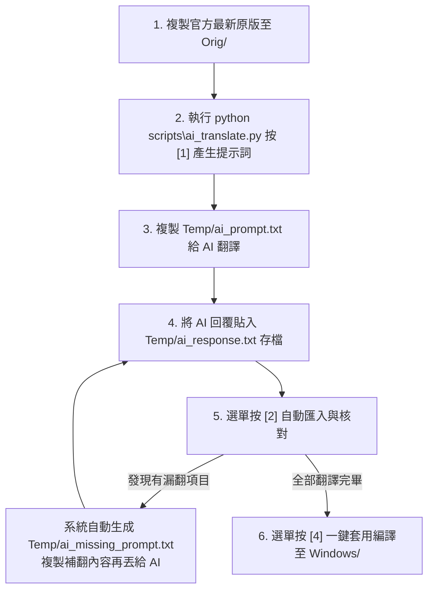

# GitHub Desktop 繁體中文在地化專案 🇹🇼

針對 **GitHub Desktop**（Windows 版）的繁體中文在地化套件與自動化翻譯工具。  
本專案提供預編譯的中文化檔案，並內建**全自動互動式數字選單**與 **AI 協同翻譯工作流**，讓任何人都能在官方釋出新版本時，一鍵提取、配合 AI 全自動翻譯、自動抓漏補正，輕鬆產出最新版的繁中介面！

---

## 📌 版本支援

- **GitHub Desktop 官方最新版本**：`v3.6.10`
- **系統需求**：Windows 10 / 11、Python 3.8+（僅自行編譯/翻譯時需要）

---

## 🚀 快速安裝（一般使用者）

如果你只想直接使用繁體中文化版本：

1. **關閉 GitHub Desktop**（請確保背景處理序已完全結束）。
2. 下載或取得本專案 `Windows/` 資料夾內的兩個檔案：
   - `Windows/main.js`
   - `Windows/renderer.js`
3. 將這兩個檔案複製並覆蓋到你的 GitHub Desktop 安裝路徑：
   ```text
   %LOCALAPPDATA%\GitHubDesktop\app-*\resources\app\
   ```
4. 重新啟動 GitHub Desktop，即可享受繁體中文介面！

---

## 🎮 最無腦操作：全自動互動式選單工作台

為了免去使用者反覆手動打各類指令的困擾，本專案提供**全自動互動式數字選單**！

👉 **啟動方式**：直接在專案根目錄開啟終端機（PowerShell 或 CMD），執行以下指令即可進入選單：
```powershell
python scripts\ai_translate.py
```

```text
=======================================================
    🇹🇼 GitHub Desktop 繁體中文化 - 自動化工作台
=======================================================
  目前字典收錄詞條數：518 筆
-------------------------------------------------------
  [1] 掃描並產生 AI 提示詞 (預設跳過已翻譯，直接翻未翻譯的)
  [2] 貼上/匯入 AI 翻譯結果 (自動合併 + 自動偵測抓漏)
  [3] 檢視缺漏清單 / 開啟補翻提示詞檔案
  [4] 一鍵編譯套用 (輸出至 Windows/ 目錄)
  [5] 批次快速翻譯 (自訂批次數量，適合大量翻新)
  [6] 開啟專案工作資料夾 (Temp / Windows / Orig)
  [0] 離開選單
=======================================================
👉 請輸入選項數字 [0-6]:
```

### ✨ 特色亮點
- **智能過濾（不重複翻譯）**：掃描時**自動排除目前已收錄的譯文**，只專注翻譯官方新版中未翻譯的新字串，大幅省時與節省 AI Token！
- **自訂批次數量（大量翻新）**：
  - 預設批次量調高至 **150 筆**。
  - 在選單中可**自由輸入任意數字**（例如 200, 300, 500 等），或輸入 **`all`** 一次性匯出所有未翻譯字串，極致高效！
- **純數字選單**：全流程只需敲數字與 Enter，無腦直覺。

---

## 🤖 翻譯標準工作流程（搭配 AI 互動）



### 詳細四步操作指南

#### 步驟 1：準備官方新版檔案
將官方新安裝目錄 `%LOCALAPPDATA%\GitHubDesktop\app-*\resources\app\` 內的未修改檔案覆蓋至專案的 `Orig/` 目錄：
- `Orig/main.js`
- `Orig/renderer.js`

#### 步驟 2：選單按 `[1]` 產生提示詞
- 系統自動掃描 `Orig/`，**自動過濾已翻譯項目**。
- 自動建立包含台灣 Git 術語規範的提示詞：`Temp/ai_prompt.txt`。
- 自動準備好空白回填檔：`Temp/ai_response.txt`。

#### 步驟 3：複製給 AI 並貼回存檔
1. 開啟 `Temp/ai_prompt.txt` 全選複製貼給 ChatGPT / Claude / Gemini。
2. 將 AI 回覆內容貼入 `Temp/ai_response.txt`（支援 **JSON** 或**純文字**雙格式）並存檔。

#### 步驟 4：選單按 `[2]` 匯入與自動抓漏
- 系統自動合併字典。
- ⚠️ 若 AI 漏翻，終端機會直接提示漏了幾筆，並**自動打包成 `Temp/ai_missing_prompt.txt`**，只需再次發給 AI 並貼回即可！
- 全部無漏後，於選單按 `[4]`，立即產生最終檔案至 `Windows/`，覆蓋回官方目錄即完成！

---

## 📂 檔案角色說明

| 檔案路徑 | 角色定位 | 說明 |
| :--- | :--- | :--- |
| `scripts/ai_translate.py` | 互動工作台主程式 | 執行直接開啟數字選單介面 |
| `Orig/` | 官方原始碼 | 放官方未修改的 `main.js` 與 `renderer.js` |
| `Windows/` | 翻譯產出物 | 替換完成的中文化 bundle，直接覆蓋安裝目錄使用 |
| `Temp/UserTemp.zh` | 核心字典 | 保存所有「英 ➜ 繁中」對照規則 |
| `Temp/ai_prompt.txt` | 提示詞 | 由腳本產生，複製傳給 AI 翻譯 |
| `Temp/ai_response.txt` | 回填檔 | 貼入 AI 回覆內容的地方（支援純文字與 JSON） |
| `Temp/ai_missing_prompt.txt`| 補翻檔 | 當 AI 有漏翻時，腳本自動生成的二次提示詞 |

---

## ⚖️ 授權與免責聲明

- 本專案僅為第三方繁體中文在地化資源與自動化工具，與 GitHub 官方無隸屬關係。
- 專案程式碼基於 MIT 授權條款開源；修改安裝檔案具有一定風險，覆蓋前建議先行備份原檔。
